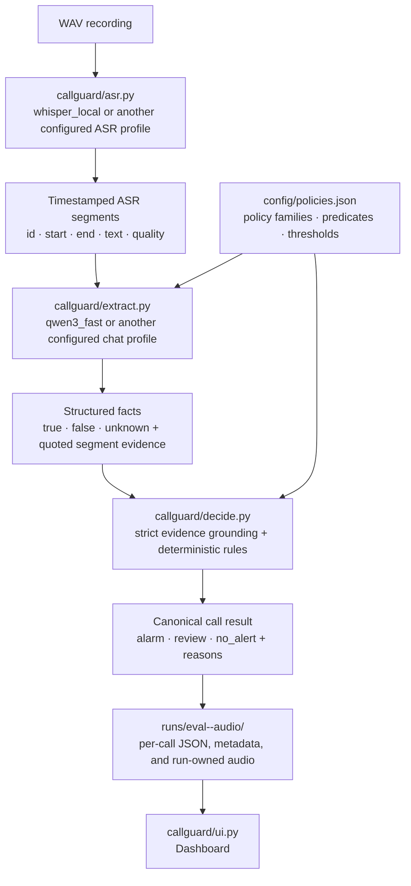
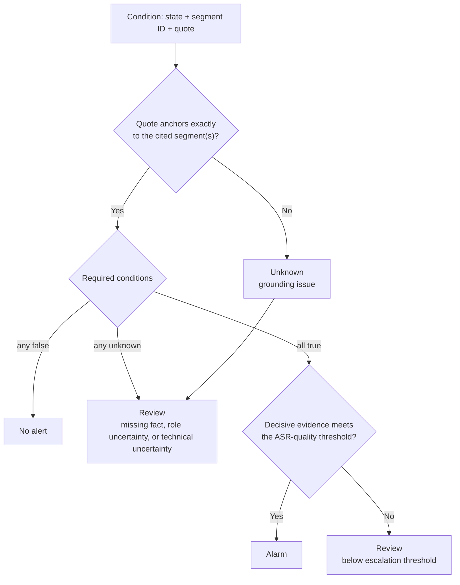
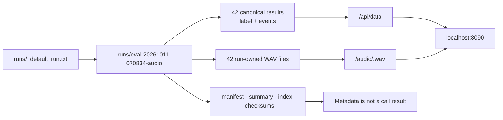

# CallGuard pipeline flow

This is the operational flow described in [PIPELINE.md](PIPELINE.md). The published default run is `runs/eval-20261011-070834-audio`, containing 42 authentic calls.

## Inference flow

Keyword matching runs over the transcript for highlighting and coverage only. It never filters the input before extraction and never changes a decision.

## Decision flow

The call label is the highest severity across all events. Review settings offer fixed thresholds of 0.6, 0.7, and 0.8; changing one recomputes decisions over stored facts and does not rerun ASR or extraction.

## Dashboard data flow

On a fresh clone, `python3 -m callguard.ui` follows the pointer and opens this committed run. It therefore displays the processed list and permits evidence and audio playback without `data/Audio`, model endpoints, or a local cache.
